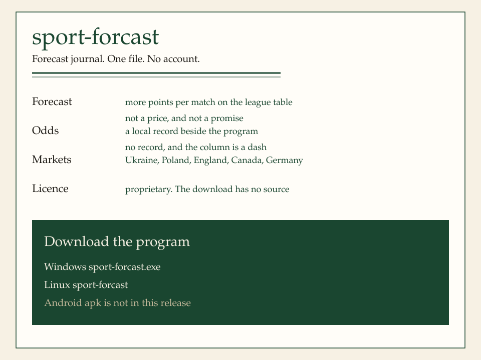

# sport-forcast

  

A proprietary football journal. One file, no installer, no account. The download does not contain source.

## What the page shows

Five markets: Ukraine, Poland, England, Canada, and Germany. The page languages are English, Polish, and Ukrainian (`?lang=en`, `?lang=pl`, `?lang=uk`).

**Forecast.** The side with more points per match on that league's recorded table. The list runs from the widest gap. That is not a betting price and not a promise.

**Odds.** A separate column. A figure appears only when `odds.txt` sits beside the program, with source `local`, a note that display is allowed, and a check date. The program does not open a bookmaker and does not invent a price. Without that file the column is a dash.

A bookmaker link is printed only when that country has a recorded legal list. Ukraine, England, and Canada have no betting link on this page.

## Open it

Download the file and run it. The journal listens on `http://127.0.0.1:9741`. English: `http://127.0.0.1:9741/?lang=en`.

## Files

| File | Who it is for |
|------|----------------|
| [sport-forcast.exe](https://github.com/platinoff/sport-forcast-bin/releases/download/v0.2.1/sport-forcast.exe) | Windows |
| [sport-forcast](https://github.com/platinoff/sport-forcast-bin/releases/download/v0.2.1/sport-forcast) | Linux x86_64, one file, no shared libraries |

An Android apk is not in this release. An empty package is not attached.
